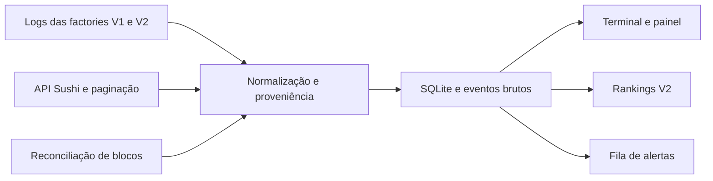

# Investigação: monitor Sushi Launch V1/V2

> Atualização posterior à investigação: monitor implementado e iniciado em 10/09, 23 testes aprovados e backfill on-chain concluído: 2.657 tokens (2.643 V1 + 14 V2). A API inicial omitiu dois registros. Consulte README.md, VALIDACAO_MONITOR.md e validation/acceptance.json para o estado operacional e a evidência final.

Texto abaixo preserva a fotografia da fase inicial, antes da autorização para implementar.

Consulta realizada em 10/09/2026, UTC/GMT+0. Escopo: pesquisa, consultas públicas read-only, snapshot e especificação. Nenhuma carteira, assinatura, compra, broadcast, mensagem externa ou monitor permanente foi iniciado.

## Resultado principal

É viável capturar lançamentos sem depender de recarregar a interface. A API oficial já reconhece `SUSHI_V2` e o contrato V2 já emitiu lançamentos reais na Robinhood Chain. A abertura pública prevista para 11/09/2026 foi informada pelo usuário após conversa direta com o responsável; horário UTC, momento da abertura e contrato final ainda precisam de confirmação.

Na fotografia concluída às **20:21:59 UTC de 10/09**:

| Grupo | Quantidade indexada |
|---|---:|
| Sushi V1 | 2.642 |
| Sushi V2 | 13 |
| Sushi V1 + V2 | 2.655 |

Os 2.655 registros foram coletados em 27 páginas de até 100 itens. O contador permaneceu em 2.655 e a última página informou `hasNextPage=false`. Isso demonstra a cobertura da API nessa coleta, não prova que seu indexador jamais omitiu um lançamento on-chain.

Os **13 V2 foram confirmados individualmente por recibos RPC**, verificando sucesso da transação, endereço emissor, assinatura do evento, creator/token/pool indexados, quote token, nome, símbolo e timestamp. O mais antigo desse conjunto é SushiMoon, criado em 17/08/2026 às 00:26:19 UTC. Não há evidência suficiente para classificar esses tokens como testes internos, lançamentos públicos ou tokens oficiais da equipe. São tokens criados através do contrato associado à V2.

Portanto, os primeiros após a abertura pública de amanhã são um recorte diferente dos primeiros históricos da V2.

## Fontes e separação de versões

- [Página indicada](https://www.sushi.com/launch?sortBy=CREATED_AT).
- [Documentação do Launchpad](https://docs.sushi.com/launchpad/overview).
- [Documentação para integradores](https://docs.sushi.com/launchpad/integrators).
- [Repositório oficial](https://github.com/sushi-labs/sushiswap).
- [PR V2 #2242](https://github.com/sushi-labs/sushiswap/pull/2242): aberto e draft na consulta, branch `launchpad-v2`.
- [PR Pools.fun #2283](https://github.com/sushi-labs/sushiswap/pull/2283): refere-se aos providers Pools V2/V3, não ao Sushi Launch V2.
- [RPC e WebSocket da Robinhood Chain](https://docs.robinhood.com/chain/connecting/).
- [Finalidade das transações](https://docs.robinhood.com/chain/transaction-finality/).

Há quatro conceitos que o monitor precisa manter separados:

1. Versão do **launchpad**: `SUSHI_V1`, `SUSHI_V2`.
2. Outro launchpad agregado pela interface: `POOLS_FUN_V1/V2/V3`.
3. Versão do AMM: SushiSwap V3 é usado pelo Launchpad, inclusive V1.
4. `metrics.version`: revisão dos dados de mercado; não identifica a versão do launchpad.

O código master lido continha apenas SUSHI_V1 e os providers Pools. A introspecção da API de produção já retornava SUSHI_V2. Logo, a produção da API estava à frente do schema publicado no master. Um filtro copiado do frontend antigo pode perder justamente a V2.

A data de abertura pública não foi estabelecida por documentação primária nesta pesquisa. Referências secundárias a uma data anterior não foram usadas para substituir a informação direta do usuário.

## Rede, contratos e eventos confirmados

O rewrite público `/launch` aponta para `/4663/launchpad`. A lista de chains do Launchpad no código consultado contém somente Robinhood Chain, chain ID 4663. Isso não significa que toda a SushiSwap opere apenas nessa rede; é o escopo desse Launchpad.

| Provider | Contrato emissor/factory |
|---|---|
| SUSHI_V1 | `0x104F1Ab42674565EC3DF0BFEbCcC4186f72fA7ED` |
| SUSHI_V2 | `0xF1716eBf85836ffE2985db9A50dd29e5814caBe9` |

A V1 foi obtida no master oficial. A V2 foi obtida no PR oficial, na API real e nos recibos RPC. `eth_getCode` retornou bytecode em ambos. A associação para a abertura pública deve ser revalidada porque o PR continua draft.

V1:

```solidity
TokenLaunched(address creator,address token,address pool,address quoteToken,int24 startTick,string name,string symbol,uint16 reserveBps,uint256 reserveAmount,uint64 reserveUnlockAt,uint16 initialSushiFeeBps)
```

Topic0: `0xeb75611adf556ff88e68373468e6f6459cdc23d2032f4b2d8e83207d84dacda5`

V2:

```solidity
TokenLaunched(address launchCreator,address token,address pool,address quoteToken,uint8 liquidityMode,uint8 feeDisposition,address initialFeeReceiver,uint16 initialSushiFeeBps,int24 startTick,uint64 poolInitializedAt,uint16 observationCardinalityNext,string name,string symbol)
```

Topic0: `0x67d06515f05b601a4cc554da8c9a0f04285b38503d8bb9b49ae6e91d6640a123`

Os três primeiros endereços são indexed em ambas as ABIs. As assinaturas Keccak foram conferidas usando `web3_sha3` e confrontadas com os logs reais. Usar apenas o evento da V1 para ouvir a V2 falharia: a assinatura mudou.

A classificação exige **chain + emissor + ABI compatível**, acompanhada de proveniência. O nome/ticker, um PoolCreated genérico ou a simples aparição no site não provam criação pelo Sushi Launch V2. Um endereço desconhecido fica pendente de classificação até validação.

## API comprovada

Endpoint que respondeu com dados reais sem credencial:

```text
POST https://production.data-gcp.sushi.com/api/graphql
```

A documentação para integradores ainda aponta para `/api`. Esse caminho retornou HTTP 404 no teste; `/api/graphql` retornou HTTP 200 com os dados esperados. HTTP POST aqui transporta consultas GraphQL de leitura.

Consulta mínima para discovery:

```graphql
query Launches($input: LaunchpadTokensInput!) {
  launchpad {
    tokens(input: $input) {
      totalCount
      pageInfo { endCursor hasNextPage }
      edges {
        cursor
        node {
          __typename chainId provider factoryAddress
          address creator name symbol
          creationTransactionHash createdAt
          pool { address quoteToken { address symbol } }
        }
      }
    }
  }
}
```

Variáveis:

```json
{
  "input": {
    "chainId": 4663,
    "providers": ["SUSHI_V1", "SUSHI_V2"],
    "first": 100,
    "sortBy": "CREATED_AT",
    "sortDirection": "DESC"
  }
}
```

Para o próximo lote, adicionar `after` com o `endCursor` retornado e manter os mesmos filtros. A coleta histórica executada usou ASC. Respeitar o cursor como opaco; não gerar cursores manualmente.

O schema do master define default de providers como `[SUSHI_V1]`. Sempre declarar V1/V2 explicitamente e inspecionar periodicamente a enumeração de providers. Providers novos ou mudanças de schema devem gerar diagnóstico, sem serem descartados silenciosamente.

Campos disponíveis e consultados: nome, símbolo, contrato, criador, factory, transação e data de criação, pool, quote token, supply, FDV inicial, status de indexação, descrição, links, revisão de metadados, preço, market cap, TVL e indicadores de atualização/staleness.

Campos específicos da V2 também responderam em produção: `launchCreator`, `currentSupply`, `feeReceiver`, `feeReceiverLocked`, `liquidityMode`, `feeDisposition`, `feeSplit`, `devBuy`, `burns` e `poolInitializedAt`.

Enums V2 do PR: liquidityMode STANDARD=0 ou MOON=1; feeDisposition DIRECT_PAYOUT=0, BURN_LAUNCH_TOKEN_FEES=1, BUYBACK_AND_BURN=2. O modo inicial decodificado do evento deve ser preservado separadamente do estado atual da API. Foi observado um caso real: SushiMoon nasceu com DIRECT_PAYOUT e a API atual retorna BUYBACK_AND_BURN.

`metrics` pode ser null e métricas existentes podem vir com `isStale=true`. Nenhum desses estados deve impedir o alerta de criação. `indexingStatus=CONFIRMED` é um status da API e não deve ser apresentado como prova de finalidade L1.

O código do frontend consulta discovery a cada 10 segundos quando live. Há SSE em `/stream/launchpad/events`, parametrizado por `chainId`, `tokenAddress` e `after`, para atividade de um token. Não foi demonstrado um SSE global de novas criações. Não usar esse stream individual como substituto do watcher de factory.

## Monitor proposto

Arquitetura sugerida: um serviço local TypeScript/Node com cliente EVM, SQLite e processos supervisionados. A escolha é uma recomendação; nenhum serviço contínuo foi implementado nesta investigação.



### Captura

- Fonte de criação: logs das factories via WebSocket RPC (`eth_subscribe logs`) quando houver endpoint disponível.
- Recuperação e verificação: `eth_getLogs` em blocos contíguos, com cursor persistido e lotes adaptados ao limite do provider.
- API: descoberta redundante e enriquecimento. Proposta inicial de polling: 2 a 5 segundos durante a abertura, conforme rate limits/erros; backoff com jitter em 429/5xx. Intervalo de polling não é promessa de latência fim a fim.
- Na inicialização, registrar o head, estabelecer a captura live e reconciliar uma janela sobreposta com deduplicação. Depois de queda, retomar do último bloco persistido e conferir a continuidade dos hashes.
- Revarrer janelas recentes da API, pois a indexação pode inserir tokens atrasados. Não parar permanentemente ao encontrar o primeiro token já visto e não olhar apenas uma página em períodos movimentados.
- Capturar criação antes de buscar social/mercado, para consultas lentas de enriquecimento não atrasarem alertas.

### Persistência e ordem

- Chave do token: `(chainId, tokenAddress)`; nunca ticker.
- Identidade da ocorrência do evento: `(chainId, blockHash, transactionHash, logIndex)`, com vínculo lógico ao token e estado de canonicidade. Isso permite arquivar ocorrências órfãs e reincorporadas.
- Ordem on-chain: `(blockNumber, transactionIndex, logIndex)` dentro da chain.
- Registrar `blockTimestampUtc`, `firstObservedAtUtc`, `apiFirstSeenAtUtc`, fonte, status e RTT separadamente. O probe histórico deste relatório não mediu latência de detecção de um lançamento ao vivo.
- Preservar dados brutos e revisões dos metadados. A linha de criação é imutável; alteração de creator/fee receiver/fees é outro evento ou estado versionado.
- Manter estados `observed`, `receipt_verified`, `posted_to_l1`, `l1_finalized` e `orphaned` apenas quando existir evidência do estágio. N blocos L2 não equivalem automaticamente a finalidade Ethereum.
- Alerta inicial pode ser provisório. Reorg implica correção e recálculo do ranking, sem duplicação silenciosa.

### Dois rankings indispensáveis

1. Histórico da V2: começa no início do contrato e exige backfill on-chain para alegar cobertura completa. Por enquanto há ranking dos 13 indexados e verificados.
2. Após abertura pública: começa em um marcador autorizado e registrado: horário UTC e, idealmente, bloco/transação da ativação. Registros anteriores continuam no histórico, identificados como anteriores ao corte, sem presumir que eram testes.

Não inventar `launchAt` como meia-noite. Até receber o horário/marcador, manter o corte como pendente. Se o contrato final mudar, observar o antigo e o novo durante a transição e versionar o registro de deployments.

### O que aparece para cada token

Nome/ticker, CA copiável, provider e factory, criador original/atual, pool e quote token, bloco/tx/log, data de criação UTC, data de recepção UTC, atraso observado, posição no ranking aplicável, modo Standard/Moon, modo de fees inicial/atual, dev buy quando disponível, site/X/Telegram/descrição, preço/TVL/market cap/volume e sinalização de dado ausente ou stale.

Links sociais são declarados pelo criador: sua presença não autentica o perfil nem a afiliação do token. Exibir o link exato recebido e não executar automaticamente conteúdo externo.

### Infraestrutura

O RPC público HTTP funcionou nos probes. A documentação da Robinhood o classifica como limitado e não recomendado para produção. Para reduzir risco de indisponibilidade na abertura, usar endpoint dedicado com WebSocket, leituras históricas suficientes e um fallback independente; validar quotas antes.

A documentação lista Alchemy e alternativas QuickNode, Blockdaemon, dRPC e Validation Cloud. Não foi usado endpoint pago, acessada credencial existente ou testada assinatura WebSocket de produção.

O sequencer feed público é um protocolo distinto de JSON-RPC logs. Pode ser investigado numa etapa posterior de otimização de latência; não é requisito para a primeira versão do monitor.

Para rodar amanhã, o processo precisa estar em máquina ligada e sem suspensão, ou num servidor persistente, com reinício automático, healthcheck, alerta de atraso do cursor e retomada de lacunas. Arquivo JSON salvo e chat aberto não constituem monitor ativo.

## Validação executada e limites

| Checagem | Resultado |
|---|---|
| Página /launch | HTTP 200 via consulta direta |
| GraphQL /api | HTTP 404; divergência da documentação registrada |
| GraphQL /api/graphql | HTTP 200, consultas e enum de providers válidas |
| Snapshot Sushi V1/V2 | 2.655 únicos, 27 páginas, fim da paginação |
| RPC chain ID | 0x1237 = 4663 |
| Bytecode V1/V2 | Presente |
| Recibos V1 | 3 consultas com sucesso e logs da factory |
| Recibos V2 | 13/13, campos de criação conferidos |
| Hash do evento | V1 e V2 conferidos com web3_sha3 |
| eth_getLogs | 1 bloco V1 e blocos do mais antigo/mais recente V2; eventos recuperados |
| Campos adicionais V2 | 13 registros retornados em produção |
| API Blockscout de código verificado | HTTP 403; auditoria do source Solidity completo não concluída |
| WebSocket/reconexão/reorg/latência live | Não testados; monitor ainda não implementado |
| Backfill de todos os blocos desde deployment | Não executado |

Nenhuma conclusão de segurança econômica, legitimidade do token, ausência de rug ou rentabilidade decorre desses testes. A validação prova o caminho de observação e a procedência técnica dos eventos descritos.

## Próxima implementação e critérios de pronto

1. Implementar captura V1/V2, armazenamento, terminal e recuperação de lacunas.
2. Configurar RPC WebSocket/HTTP persistente; conservar API como redundância e enriquecimento.
3. Validar replay sem duplicação, reconexão com perda intermediária, token sem metadata, burst acima de uma página, mudanças de provider e reorg em fixtures explícitas.
4. Fazer smoke read-only contra os blocos e recibos conhecidos, seguido de medição live real. Separar replay histórico de novos eventos observados em tempo real.
5. Registrar horário/bloco da abertura pública e confirmar factory final com o responsável.
6. Iniciar operação supervisionada e medir head lag, erros, recuperação e timestamps. Alertas Telegram/Discord somente com destino e envio autorizados.

Não é necessário esperar a interface V2 abrir para preparar a captura: contrato, eventos e filtro de API já foram identificados. A garantia de capturar todos depende de cobertura contínua por blocos, histórico acessível e registro completo dos deployments monitorados.

## Artefatos e reprodução

- `evidence/live/sushi-api-baseline.json`: baseline API de 2.655 tokens.
- `evidence/live/sushi-api-baseline-summary.json`: horários, contagem, paginação e limite de cobertura.
- `evidence/live/v2-verified.json`: 13 V2 com blocos, recibos conferidos e modo inicial.
- `evidence/live/v2-details.body`: estado atual dos campos adicionais V2.
- `research/V2_BASELINE.md`: tabela humana dos 13 registros.
- `evidence/live/*.request.json`: URL, requisição read-only, horário, status e duração.
- `evidence/live/*.body`: respostas brutas, incluindo erros.
- `evidence/source/`: recorte do master oficial em `4e40d41c61501a67cfef9105a61b9303c0043503`.
- `evidence/v2-source/`: recorte do PR oficial em `910da14a8ed43509dc5b337af0b5de3ecf85e2d9`.
- `evidence/docs-*.md`: respostas HTML brutas da documentação (extensão herdada da coleta); `docs-*.txt` contém texto extraído.
- `evidence/MANIFEST.json`: hashes SHA-256 dos artefatos de evidência.

Os scripts `research/probe_*.py`, `research/verify_v2.py` e `research/baseline_sushi.py` são probes finitos, não serviços. Executar com `python -X utf8`. Os probes de follow-up dependem dos arquivos gerados pelos anteriores. Reexecutá-los sobrescreve seus snapshots nominais: arquivar a pasta de evidências primeiro se quiser preservar esta coleta.
