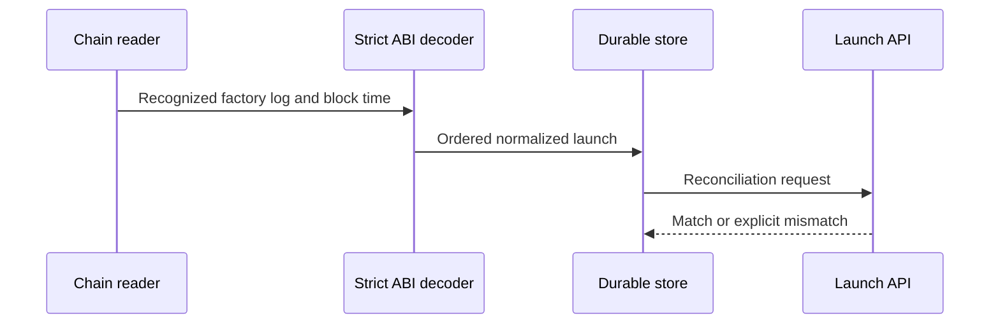

# Onchain Launch Monitor

  [](LICENSE)

A read-only Sushi launch-event monitor with durable cursors, strict receipt decoding, API reconciliation and historical gap handling.

This implementation is specifically configured for **chain ID 4663**. It is not a generic “any EVM chain” monitor: the [configuration loader](src/core.mjs) rejects an unvalidated chain configuration and derives factory topics from the configured ABI signatures.

## Event identity and reconciliation

A decoded launch retains block/transaction/log ordering, both hashes, the authoritative block time, original creator and raw log. [checkApiMatch](src/core.mjs) compares on-chain identity against API fields such as transaction, factory, pool and quote token. A mismatch is an error rather than a silently merged record.



## Verify the offline contract

```console
npm ci --ignore-scripts
npm test
```

Node.js 24+ is required. [tests/monitor.test.mjs](tests/monitor.test.mjs) is the offline regression surface; `npm run validate` is a separate acceptance command and should not be assumed equivalent to a unit test.

## Operating the monitor

[config/monitor.json](config/monitor.json) defines factories and the launch cutoff. Local `SUSHI_RPC_HTTP`, `SUSHI_RPC_FALLBACK_HTTP` and `SUSHI_RPC_WS` override provider URLs. `npm start`, `npm run status`, `npm run alerts` and `npm run backfill` expose distinct operational paths.

The original live process was paused. Cloning or publishing this source does not resume it. Backfill/API reads consume provider quotas; offline fixtures do not prove current event coverage or chain availability.

**Technology:** JavaScript ES modules · Node.js 24 · viem · SQLite · PowerShell helpers

Project-authored source: [MIT](LICENSE). Third-party components retain their own notices and terms.
